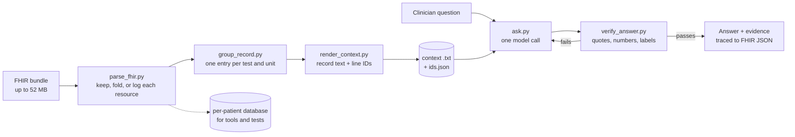

# Health Context Challenge

This project turns a patient's health information exchange (HIE) records into a compact text record that a clinician can question in plain English. Every answer quotes the record word for word, and every quote traces back to the original FHIR resource. Anything the model concludes on its own (a trend, a drug class, a judgment) is labeled as an interpretation and kept apart from the documented facts, so the clinician makes the call.

The compact record is built by code, with no LLM summarization. Nothing clinical is dropped, and tests prove it. The largest patient fits in about 184K tokens, about a fifth of the 900K budget.

## Quickstart

Needs Python 3.11 or newer. The pipeline uses only the standard library; the UI needs Flask.

```
pip install flask
```

Put your OpenRouter key in a `.env` file in this folder:

```
OPENROUTER_API_KEY=...
VOYAGE_API_KEY=...        # optional, only for the cosine column in variance.py
```

Build every patient's record once (a few minutes for all 109):

```
python build_all.py data\synthea_sample_data_fhir_latest
```

Ask a question from the command line, or open the UI:

```
python ask.py "Merlene Thompson" "What was her most recent HbA1c, and when was it taken?"
python app.py             # then open http://127.0.0.1:5000
```

Run the tests (plain Python, no pytest needed) and the evals:

```
python tests\run_all.py
python eval_generic.py --system context
```

## How it maps to the brief

| Brief | Where | Result |
|---|---|---|
| Compact context, at most 900K tokens | `build_all.py` (`parse_fhir.py`, `group_record.py`, `render_context.py`) | Largest patient about 184K tokens, median about 18K. Deterministic and lossless for clinical facts. |
| Evals that define and defend "good" | `eval_generic.py`, `compare_evals.py`, `variance.py`, `compare_general.py` | Questions generated for any patient, answer keys computed from the data, three pipelines compared, three repeat runs measured. |
| Retrieval for what doesn't fit | `tools.py` (`run_sql`, `search_notes`) | Visit notes searchable outside the context. A SQL-first mode answers from a 10x smaller index. |
| Onsite: "super small" context | `ask.py --sql-first` | Pat's record goes from 193K characters to a 17K-character index, with every value fetched by query. |
| Onsite: retrieval for arbitrary labs | eval questions use clinician names | "BUN" and "A1c" resolve to the right record items without a lookup table. |

## Design principles

The guiding idea: **AI is a revolution in understanding, not judgment.** The model reads; people decide.

| Principle | Where it is enforced |
|---|---|
| **Reading comprehension, not knowledge.** The model is a fast reader, not an oracle. | The full record goes in the prompt and the model answers from it alone. Outside knowledge, even a drug's class, must be labeled as an inference. |
| **Contained justification.** Verbatim facts and inference never blur together. | Every fact needs an exact quote. Every judgment is marked `(inferred: ...)` and listed with the quoted facts it rests on and the reasoning step. `verify_answer.py` rejects unquoted numbers and dates, and inference markers without premises. |
| **Humans hold decision authority.** | The prompt forbids treatment recommendations. The UI shows interpretations in their own section, for review. Every quote traces back to the source FHIR JSON. |
| **Abstention is a valid output.** A confident wrong answer is the failure to prevent. | "Not documented" is a first-class status and requires a note of what was searched. The prompt calls a fluent guess a failure. Every eval patient includes a test they never had. |
| **The domain expert is the final bar.** | Facts are graded against keys computed from the data, not by an LLM. No uncalibrated LLM judge is used. Cosine similarity is reported as a first filter, not a verdict. Open-ended answers are read by a person. Not yet met: no clinician has reviewed the answers or the rubric (see the gaps section). |
| **Controls against observed failures, enforced in code.** | Each verifier rule traces to a failure seen in testing: an invented number, a quote spliced with "...", "104" passing for "104.55", a cut-off reply. Whatever code can check, code checks; the prompt carries only what it can't. |

## Prompting philosophy: six elements

The system prompt (`ask.py`) has six labeled sections, and each has one job:

1. **Role.** A clinical record assistant for treating clinicians. It reports what the record says and keeps its own conclusions labeled. It does not recommend treatment.
2. **Task.** Answer every question asked, always. Every statement is either a fact the record states or an inference, and the section lists what counts as an inference: verdicts on trends, diagnoses not on the chart, calling something stopped, linking a drug to a condition, outside knowledge, anything calculated.
3. **Input context.** What the record is, how it was built, how lines and IDs work, and the source system's known flaws (statuses that never close, implausible values).
4. **Define success.** The right readings for the question, every fact quoted, current versus past made clear, judgments labeled, and an honest "not recorded" counted as success.
5. **Define failure.** Never invent a value; report both values when two share a date; state the reading of an ambiguous question; never state a judgment as fact, even a correct one.
6. **Define the output.** The JSON contract (status, answer, evidence, inferences, checked) that `verify_answer.py` checks, with one worked example.

The rule behind the split: anything code can check is checked in code. The prompt states the rule so the model tries to follow it, and the verifier makes sure it did.

## The pipeline, step by step



**Built once, ahead of time:**

1. **Parse.** Every resource in the bundle gets exactly one fate: kept, folded into another (a Medication is named inside the order that points to it), or removed with a logged reason.
2. **Group.** Repeated measurements are grouped by test and unit, so a test's name, code, and unit are written once instead of once per reading.
3. **Render.** The grouped record becomes text with a legend, sections, and an ID on every line (`[L12]`). A map file links each ID to its source FHIR resources.

**For each question:**

4. **One call.** The system prompt, the patient's record (cached, so later questions about the same patient are cheap), and the question go to the model. It replies in JSON.
5. **Verify.** Code checks every quote, number, date, and inference label. If anything fails, the problems go back to the model, which gets up to two tries to fix them. An answer that still fails is shown as NOT VERIFIED.
6. **Trace.** In the UI, each quote expands to the full chart line and then to the original FHIR JSON behind it.

## The context: what was cut, what was kept, and why

**The data.** 111 files (109 patients plus 2 shared files), 386 MB, about 120,000 FHIR resources. The median file is 2.3 MB; the largest is 52.3 MB. Two findings shaped the design: about 47% of the bytes are billing (Claims and ExplanationOfBenefits), and the clinical data is mostly the same coded measurements repeated over years (46,305 observations).

**A first attempt, and why it was replaced.** An early normalizer cut 97% of the bytes with zero structural errors but produced 1,111 warnings and had no way to show what was lost. A big reduction is not evidence that the removed data was redundant. The rebuild accounts for every resource.

**What was removed, each with a logged reason:**

- billing: Claims and ExplanationOfBenefits
- audit: Provenance
- 5,635 DiagnosticReports that were exact copies of visit notes already stored
- identity numbers (SSN, driver's license, passport), stripped on purpose

The shared practitioner and hospital files are used to resolve names, then not repeated.

**How the rest was made compact, with nothing summarized:**

- **One line per thing measured.** Eight HbA1c records become one line with eight dated values. This is the largest saving.
- **The most important part first.** Each line leads with what was measured, then the count, the latest value and date, and the range, then the full history:
  `[L12] Hemoglobin A1c/Hemoglobin.total in Blood (LOINC 4548-4) % | n=8 | latest 6.31 on 2025-09-29 | range 5.88-6.33 | 2016-09-26 5.99 · ...`
  The model finds "latest" without scanning a long series, and the clinician sees the current value first when the UI shows the evidence.
- **Repeated values collapsed, value first.** "Never smoked (8x): date, date, ..." writes the value once. A round-trip check proves every reading expands back exactly. This saved 28% of the text on Cole's record and 24% on Pat's.
- **Visit notes kept out, but searchable.** In this synthetic data the notes are templated restatements of the structured data, so they stay in the database with keyword search instead of in the context.

**Size.** Real token counts: Cole 183,510, Pat 123,917, Maurice 93,795, Emmanuel 71,083, median about 18K. Character-based estimates undercounted by about 2.5 times, so real counts were used.

## Testing

Tests prove the code does what it claims; evals (next section) measure how good the answers are. `python tests\run_all.py` runs 135 tests in seconds:

| File | Claim it checks |
|---|---|
| `test_data.py` | Nothing clinical is lost: every resource in every bundle is kept, folded, or logged; every reading survives the compression on all 109 patients; every line ID maps to FHIR resources that exist. |
| `test_verify_answer.py` | Each verifier rule catches the failure it was built for: reworded or spliced quotes, unknown IDs, unquoted numbers and dates, "104" for "104.55", unlabeled calculations, inference markers without premises. |
| `test_ask_offline.py` | With a stand-in model (no API key, no cost): the prompt has its six sections in order, a good answer passes first time, a bad one is sent back and fixed, and after two failed fixes the answer is marked NOT VERIFIED. |
| `test_scorer.py` | The eval scorer measures what it says: database numbers match the key, labeled judgments pass, unlabeled ones fail, and statements about the record ("not labeled abnormal") are not counted as judgments. |

When `ask.py` was split into `ask.py`, `tools.py`, and `common.py`, a one-time check confirmed identical prompts and identical model requests in all three modes, so earlier eval results stayed valid.

## Evals

**What "good" means.** An answer is good if it:

- has the right values and dates
- quotes every fact
- says "not documented" when something isn't there
- labels every judgment
- is fast and cheap enough to use

This definition is mine, not a clinician's; see the first item under "Compromises and known gaps".

**How it generalizes.** `eval_generic.py` generates questions for any patient from that patient's own data, and computes the answer key from the database, never from the context text. Five kinds per patient:

- **Simple:** a latest lab value
- **Complex:** the drugs ordered for a diagnosis
- **Multi-part:** one question that includes a test the patient never had, which must come back as not documented
- **Trend:** first and latest readings must appear, and any verdict must be labeled
- **General:** "What is currently wrong with this patient?", read by a person

It runs on a small, medium, and large patient (Byron, Rogelio, Pat), with lab names in clinician wording ("BUN", "A1c").

**Three pipelines on the same 15 questions:**

| | Record only | Record + tools | SQL-first |
|---|---|---|---|
| Correct (code-graded) | 12/12 | 12/12 | 11/12 |
| Passed the verifier | 15/15 | 15/15 | 15/15 |
| Model calls | 16 | 29 | 60 |
| Fix calls | 1 | 4 | 8 |
| Cost | $1.78 | $2.55 | $2.30 |
| Time | 205s | 277s | 422s |

The record alone was as accurate, and the fastest and cheapest. It also abstained correctly on every test the patient never had, just by reading: because the record is complete, "not in the record" means "not in the patient's data." SQL-first's one miss was the same question in two runs, a long 78-reading series it described in its own words instead of labeling.

**Variance across three runs of the record-only pipeline:**

| | Cited lines | Values | Status | Pass | Cosine |
|---|---|---|---|---|---|
| All questions | 0.81 | 0.86 | 1.00 | 0.94 | 0.97 |
| General question | 0.74 | 0.70 | 1.00 | n/a | 0.95 |

Verdicts never changed between runs. Cosine similarity said the answers were nearly identical (0.97) while the facts they drew on varied much more on open questions (0.70). That's why cosine is a first filter, not a verdict.

**The general question, read by hand.** All three pipelines got every fact right and labeled every judgment. They differed in which stale or conflicting entries they flagged:

| Stale or conflicting entry | Record only | Record + tools | SQL-first |
|---|---|---|---|
| Rogelio: 2003 sepsis still "active" | yes | yes | yes |
| Pat: CKD stages 1-3 still "active" next to stage 4 | no | yes | yes |
| Pat: obesity diagnosis vs. latest BMI 28.71 | yes | yes | no |
| Pat: prediabetes next to type 2 diabetes | no | no | yes |
| Pat: HbA1c 4.18% while on insulin | no | no | no |

Consistent on facts, inconsistent on judgment. That is the case for keeping the clinician in the loop, and for a deterministic "record conflicts" check as a next step.

## Retrieval

- **`search_notes`:** keyword search over the visit notes, which are kept out of the context.
- **`run_sql`:** read-only SQL on the patient's database, for exact counts and filtered lookups. It can't write, can't open another patient's file, times out after 5 seconds, and returns at most 200 rows.
- **SQL-first** (`ask.py --sql-first`): the model gets only an index of item names and codes, about 10 times smaller, and must fetch every value by query. It answers the "super small context" question at the cost of twice the calls.

Since every record fits, the record-only pipeline is the default; tools are optional (`--tools`).

## Compromises and known gaps

**The biggest gap: no clinician shaped or checked the evals.** I defined what "good" means, chose the question types, decided which stale entries matter, and read the open-ended answers myself, as a careful non-clinician. By my own principle the domain expert is the final bar, and that bar hasn't been applied yet. What it would take:

1. **A clinician co-writes the rubric.** Which questions matter in practice, what a complete "what's wrong with this patient" answer must include, and which errors are dangerous versus cosmetic (a missed stale status is not the same as a wrong value).
2. **The clinician labels a golden set.** For example 30 to 50 saved answers, each marked correct or incorrect, complete or incomplete, with any unlabeled judgment noted.
3. **Only then an LLM judge,** calibrated against those labels with its agreement reported, to scale the review to every patient.

Everything code can grade (values, dates, quotes, abstention) is already graded against keys computed from the data. The open questions are the judgment calls, and those need a clinician.

**Other gaps:**

- **Words can't be checked in code.** Numbers, dates, and quotes are verified; an unlabeled judgment in words ("thrice-weekly", "stable") can slip through. The eval measures this with a word list that has known false alarms.
- **A quote can exist without supporting its sentence.** Catching that needs a judge calibrated against human labels, or a person.
- **Retrieval is built but not evaluated.** No eval question needs the visit notes. Next: questions whose answers live only in notes, run with and without tools.
- **Notes were judged templated from reading samples,** not proven by an eval. With real clinical notes this tradeoff needs re-testing.
- **Tokens were counted through OpenRouter's usage report,** not Anthropic's `count_tokens` endpoint. With a fivefold margin under the cap, the outcome can't change, but the official count is a quick next step.
- **Small eval.** 15 questions on 3 patients, with three repeat runs. Directional, not definitive.
- **SQL results don't trace back to FHIR in the UI.** Record-line citations do; query rows don't carry resource IDs yet. The UI uses the record-only pipeline for this reason.

**Next steps:**

- clinician review: a co-written rubric, a labeled golden set, then a calibrated judge
- the notes-retrieval eval
- the official token count
- a deterministic record-conflicts pass (stale statuses, superseded stages, a diagnosis contradicted by the latest value)
- year-grouped dates (about 9 tokens per date down to 6) for a smaller context

## Files

**Build the context (run once)**

- `build_all.py`: runs the steps below in order
- `parse_fhir.py`: bundle to database, with every removal logged in `out/removed`
- `group_record.py`: database to grouped record, one entry per test and unit
- `render_context.py`: grouped record to context text, the line-ID map, and the round-trip check
- `build_patient_index.py`: `patients.csv`, used for name lookup

**Answer questions**

- `ask.py`: the main pipeline (prompt, one call, check-and-fix loop) and the command line
- `verify_answer.py`: the deterministic answer checks
- `common.py`: patient lookup, model calls, caching, trace printing
- `tools.py`: the record + tools and SQL-first pipelines
- `app.py`, `templates/`, `static/`: the web UI

**Evals**

- `eval_generic.py`: questions and answer keys for any patient, scoring
- `compare_evals.py`: runs side by side
- `variance.py`: agreement across repeat runs
- `compare_general.py`: open-ended answers side by side, for reading

**Other**

- `tests/`: the test suite (`python tests\run_all.py`)
- `analysis/`: the exploration that shaped the design (profiling, sizing, repetition, date tokens, token counts)
- `archive/`: superseded code (the first normalizer, the Cole-only eval)
- `out/`: generated, ignored by git except `out/evals/`, which holds the eval results behind the numbers above
